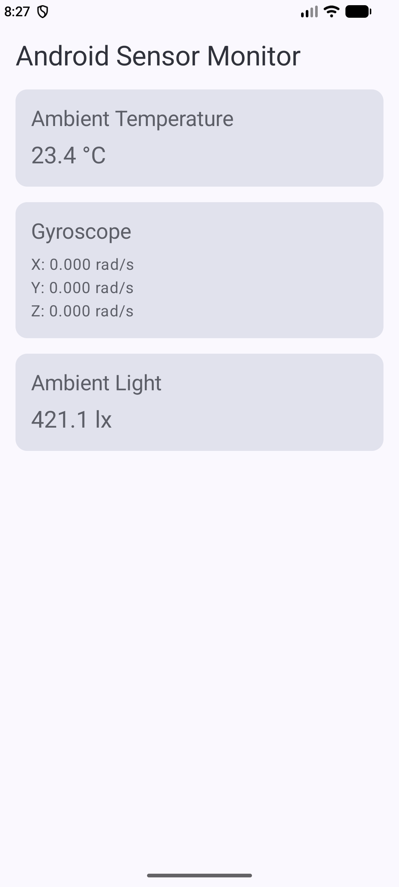

# Lab 6 - Reading Android Device Sensors

Course: COMP3074 - Mobile App Development I
Student: Teni

## About the app

SensorLab displays ambient temperature in degrees Celsius and gyroscope readings for the X, Y and Z axes in radians per second. If a sensor is missing, the app shows an unavailable message.

The app follows the sensor-monitor example in the course's Reading Android Device Sensors lab. It uses Kotlin and Jetpack Compose. Listeners start in `onResume()` and stop in `onPause()`.

For Part 18, the app also reads the ambient light sensor and displays the value in lux. It handles a missing light sensor in the same way as the other sensors.

## Running the project

Open the project in Android Studio, let Gradle sync, then run the app on an Android device. The handout recommends a physical device. Emulator sensor controls can also be used for practice.

## Device testing

Tested using the Medium Phone API 37.2 Android Emulator on November 10, 2026. These are simulated sensors; physical-device sensor availability has not been tested.

- Ambient temperature: available in the emulator; the screenshot shows 23.4 °C.
- Gyroscope: available in the emulator; the screenshot shows X, Y and Z at 0.000 rad/s while stationary.
- Ambient light: available in the emulator; the screenshot shows 421.1 lux.
- Landscape layout: vertical scrolling was checked and the Ambient Light card could be reached.
- Gyroscope changes during movement: confirmed during emulator testing.
- Pause and resume behaviour: confirmed; readings continued updating after returning to the app without crashing.
- Missing-sensor behaviour: handled in the code, but not yet tested on a device without the sensors.

## Screenshot

The screenshot below shows the app running on the test emulator.

## Reflection questions

### 1. Why can getDefaultSensor() return null?

Some devices do not have the requested sensor. Checking for null lets the app show an unavailable message instead of trying to use a sensor that is missing.

### 2. Why unregister listeners when the activity is paused?

The readings are not needed while the activity is paused. Removing the listener avoids unnecessary sensor callbacks and battery use. The listener is registered again when the activity resumes.

### 3. How are angular velocity and orientation different?

Angular velocity describes how quickly the device is rotating. Orientation describes the direction it is facing. A tilted phone that is held still can have gyroscope readings close to zero.

### 4. What units does the gyroscope use?

Each axis uses radians per second, written as rad/s.

### 5. Why not use battery temperature as ambient temperature?

Battery temperature measures the battery rather than the surrounding air. Charging and running apps can warm the battery, so its temperature is not a suitable replacement.

### 6. How does mutableStateOf update the screen?

Compose observes the state values read by the UI. When a sensor callback changes one of those values, Compose updates the parts of the screen that use it.
